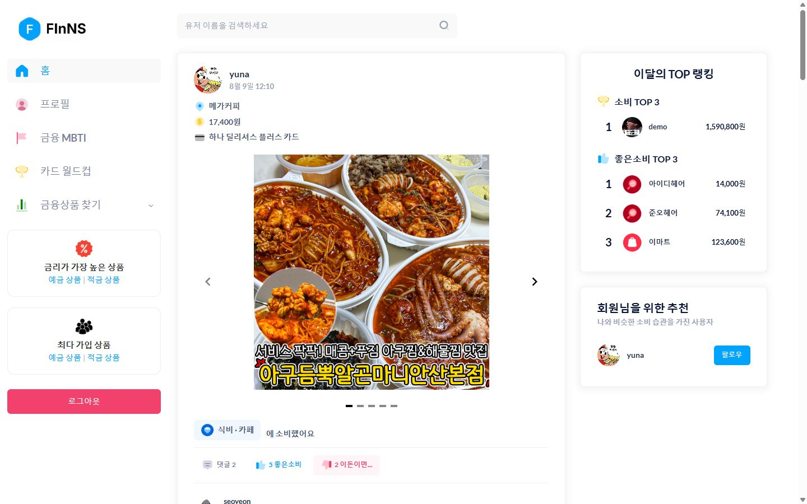
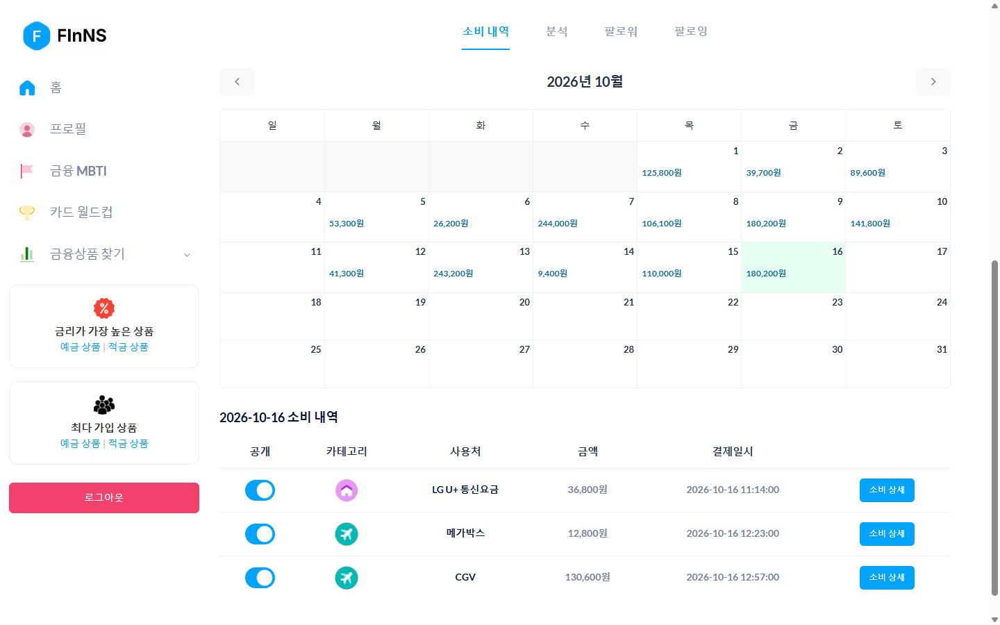
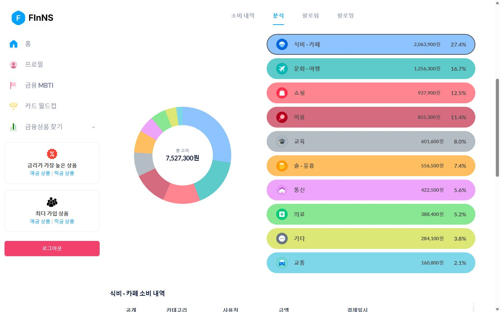
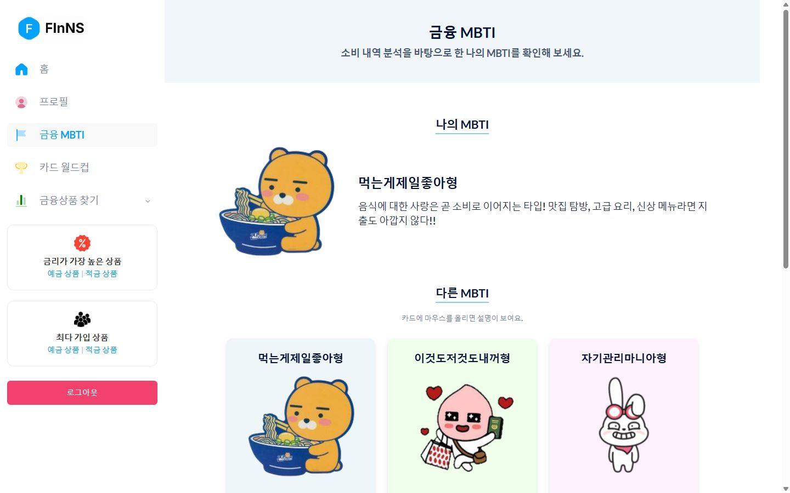
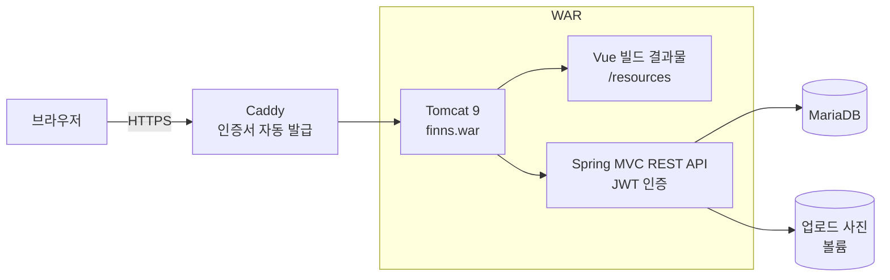

# finNS — 소비 내역 공유 금융 SNS

카드 결제 내역이 소비 게시글이 되고, 친구의 소비에 '좋은소비 / 이돈이면...'으로 반응하는 소비 공유 SNS입니다.
쌓인 소비 데이터로 소비 성향(금융 MBTI) 9가지 중 하나를 진단하고, 성향에 맞는 카드와 예·적금을 추천합니다.

**🔗 사이트: https://finnss.duckdns.org** — 로그인 화면의 **체험 계정으로 둘러보기** 버튼으로 바로 들어갈 수 있습니다.

- 기간: 2024-09-22 ~ 2024-10-16 (팀 프로젝트), 이후 개인 리팩터링·배포
- 저장소 구성: 팀 저장소 두 개(백엔드·프론트)의 커밋 기록을 그대로 합친 모노레포

| 메인 피드 | 소비 달력 |
| --- | --- |
|  |  |
| **소비 분석** | **금융 MBTI** |
|  |  |

## 주요 기능

- JWT 로그인, 회원가입, 체험 계정 로그인
- 메인 피드: 사진이 있는 공개 소비글(무한 스크롤), 좋은소비 Top 3, 이달 지출 Top 3 회원
- 소비 달력과 날짜별 내역, 소비 글 공개 범위·카테고리·메모 수정
- 반응(좋은소비/이돈이면...)과 댓글
- 카테고리별 소비 분석, 금융 MBTI 진단, 같은 성향 회원 추천
- 팔로우, 사용자 검색, 최근 본 사용자
- 예금·적금 검색·필터, 카드 추천, 카드 월드컵

## 기술 스택

| 영역 | 기술 |
| --- | --- |
| 프론트엔드 | Vue 3, Vite 8, Vue Router 4, Pinia, axios, FullCalendar, Metronic(Bootstrap 5) 테마 |
| 백엔드 | Java 17, Spring MVC 5.3, Spring Security 5.8, jjwt 0.11.5, MyBatis 3.4, Swagger |
| 데이터 | MariaDB 11 (MySQL 호환), HikariCP |
| 배포 | Docker Compose, Tomcat 9, Caddy(HTTPS 자동 발급), Oracle Cloud, GitHub Actions |

## 구성



- WAR 하나에 백엔드와 프론트 빌드 결과물이 함께 들어갑니다. `/profile/1` 같은 화면 주소로 직접 접속하거나 새로고침해도 서버가 `index.html`을 돌려줍니다(`SpaRoutes`).
- 서버에서는 `docker compose`가 DB·앱·Caddy 세 컨테이너를 띄우고, DB가 비어 있으면 `schema.sql`·`seed.sql`로 예시 데이터를 만듭니다.
- API 문서: `/swagger-ui.html`

```
finNS/
├── FInNS-BackEnd/     Spring MVC REST API (WAR)
│   ├── db/            schema.sql(테이블 17개), seed.sql(예시 데이터, 실행일 기준 날짜)
│   └── src/main/webapp/resources/assets/   DB가 가리키는 이미지(카드·프로필·피드·은행 로고)
├── FInNS-FrontEnd/    Vue 3 SPA
├── deploy/            Caddy 설정, 서버 초기 설정·DB 초기화 스크립트
├── docs/DEPLOY.md     Oracle Cloud 배포 순서
├── Dockerfile         프론트 빌드 → WAR 빌드 → Tomcat 이미지
└── docker-compose.yml
```

## 리팩터링으로 고친 문제

| 구분 | 문제 | 해결 |
| --- | --- | --- |
| 보안 | 로그인 없이 모든 API 호출 가능 (`anyRequest().permitAll()`) | 공개 경로만 허용하고 나머지는 인증 필수 |
| 보안 | JWT 비밀키가 소스 코드에 노출 | 설정값·환경변수로 분리 (저장소에 올리지 않음) |
| 보안 | 남의 게시글 수정 가능 (IDOR) | 토큰의 사용자 번호를 `WHERE` 조건에 추가 |
| 보안 | 비공개 글이 메인 피드에 노출 | 피드 쿼리에 공개 여부 조건 추가 |
| 보안 | Log4Shell 취약 버전(log4j-core 2.0.1) 포함 | 쓰지 않는 log4jdbc·log4j2 제거, log4j 1.x → reload4j |
| 구조 | 루트·서블릿 컨텍스트가 같은 패키지를 스캔해 빈이 두 번 생성 (보안 필터 체인 2개) | 컨트롤러는 서블릿, 나머지는 루트 컨텍스트로 분리 |
| 성능 | 사용자 목록 5곳에서 N+1 쿼리 | `EXISTS` 서브쿼리로 한 번에 조회 |
| 성능 | 템플릿 전역 JS 2.5MB + 단일 번들 566KB | 전역 JS 제거, 화면별 코드 분할 (초기 번들 103KB) |
| 버그 | 대부분 회원이 '기타'형으로 진단 | '기타'를 진단 대상에서 제외 |
| 버그 | 프로필 수정 시 소비 내역 갱신 시각이 덮어써져 일부 결제가 반영되지 않음 | 수정 SQL에서 갱신 시각 변경 제거 |
| 버그 | 예시 데이터 날짜가 고정돼 시간이 지나면 랭킹·달력이 빔 | 실행일 기준으로 날짜 생성 |
| 정리 | 템플릿 잔여 파일 2,200여 개(80MB), 강의 예제 패키지, 중복 화면 | 삭제·통합, 공용 컴포넌트·상수로 분리 |

## 로컬 실행

필요한 것: JDK 17, Tomcat 9, MariaDB(또는 MySQL 8), Node.js 22

**1. DB 만들기** (기존 `finns` DB는 지워집니다)

```bash
mariadb -u root --default-character-set=utf8mb4 < FInNS-BackEnd/db/schema.sql
mariadb -u root --default-character-set=utf8mb4 < FInNS-BackEnd/db/seed.sql
```

앱이 쓸 계정을 만듭니다.

```sql
CREATE USER 'finns'@'localhost' IDENTIFIED BY '1234';
GRANT SELECT, INSERT, UPDATE, DELETE ON finns.* TO 'finns'@'localhost';
```

**2. 백엔드 설정** — `FInNS-BackEnd/src/main/resources/application.properties.example`을 같은 폴더에 `application.properties`로 복사해 DB 비밀번호와 `jwt.secret`을 채웁니다. 같은 값을 환경변수(`JDBC_URL`, `JDBC_PASSWORD`, `JWT_SECRET` 등)로 줘도 됩니다.

**3. 개발 모드 실행** — 백엔드와 프론트를 따로 띄웁니다

- 백엔드: IntelliJ Community + Smart Tomcat 플러그인 (배포 디렉터리 `FInNS-BackEnd/src/main/webapp`, 포트 8080)
- 프론트:

```bash
cd FInNS-FrontEnd
npm install
npm run dev     # http://localhost:5173 (API와 이미지는 8080으로 프록시)
```

**4. 배포용 WAR 만들기** — 프론트를 먼저 빌드해야 합니다

```bash
cd FInNS-FrontEnd && npm ci && npm run build      # dist/ 생성
cd ../FInNS-BackEnd && ./gradlew war               # dist/ 를 WAR의 /resources 에 포함
# build/libs/finns.war 를 <tomcat>/webapps/ROOT.war 로 복사 후 Tomcat 실행
```

예시 계정: `demo` / `1234` (seed.sql의 회원 12명 모두 비밀번호 `1234`)

## 배포

Oracle Cloud 무료 VM에 Docker Compose로 배포합니다. 순서는 [docs/DEPLOY.md](docs/DEPLOY.md)에 있습니다.

```bash
cp .env.example .env    # 도메인, DB 비밀번호, JWT 키 입력
docker compose pull && docker compose up -d
```
